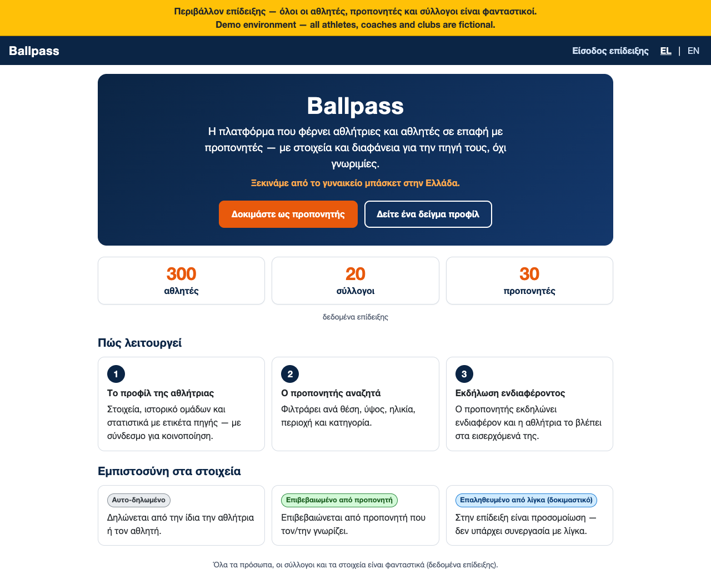
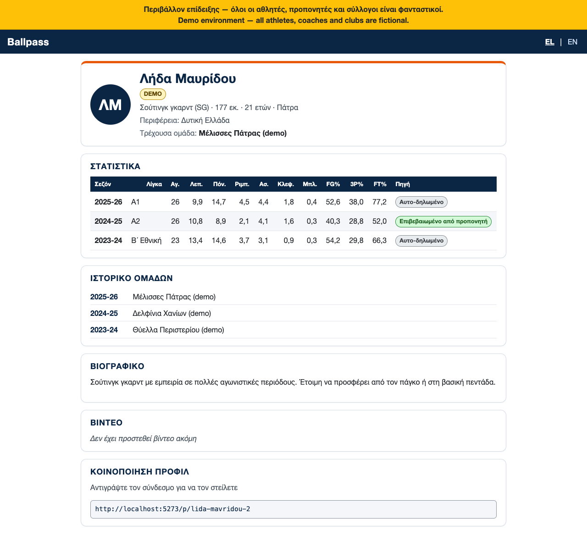
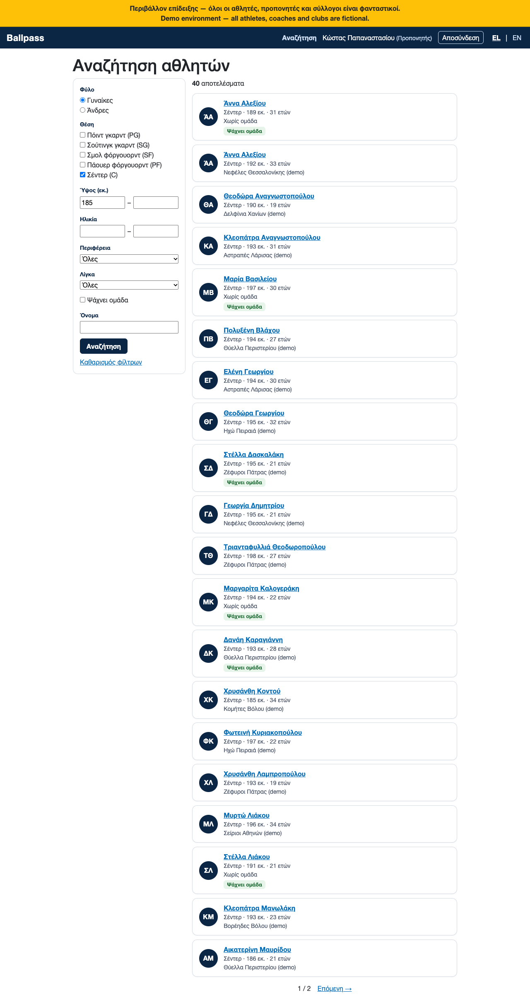
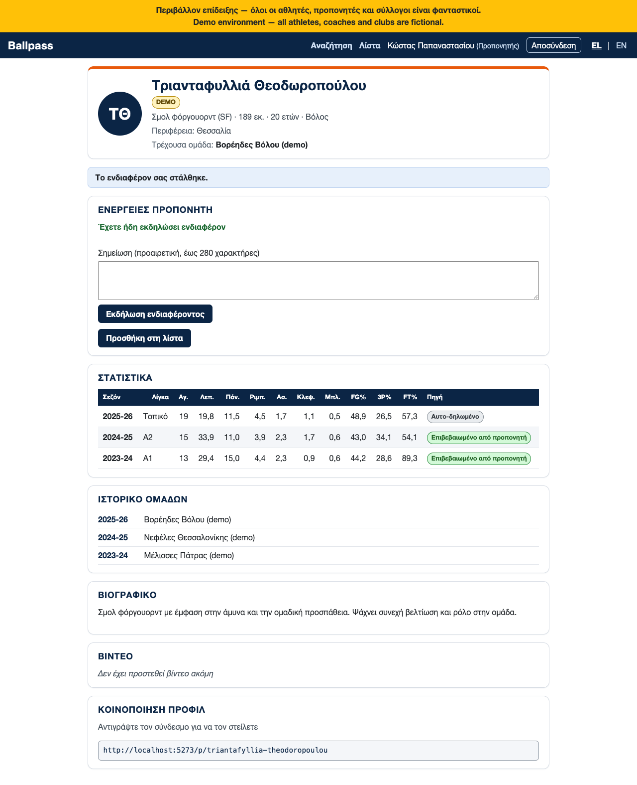
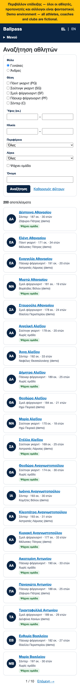
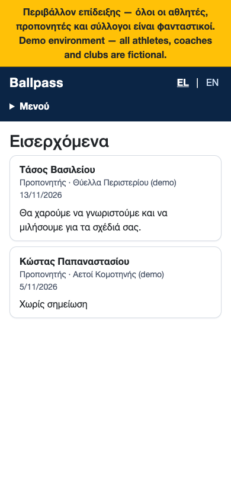

# Ballpass

Ballpass is a scouting network ("LinkedIn for athletes") that connects athletes with coaches on data with a clear source label on every stat, instead of personal connections.
Athletes keep a profile with seasons and stats (each stat carries a trust label), coaches search with filters,
express interest and keep a shortlist. It starts with women's basketball in Greece. UI in Greek (default) and English.

**Status:** investor proof of concept. All data is fictional (see [DEMO_DATA.md](DEMO_DATA.md)). Static server-rendered
Blazor; the core flows need no JavaScript.

## What's in the wow release (branch `wow-release`)

| Area | What you see | Where |
|---|---|---|
| Look | One dark theme, self-hosted Inter + Roboto Condensed (Greek), big stat numbers, WCAG-checked colours | everywhere |
| Feed | "LinkedIn for athletes": looking-for-team, tryout calls, stat updates, highlights, badges, posts; 🔥 kudos, follow, report/hide/block. No comments, no DMs | `/feed`, home strip |
| Match | Coach describes a need → ranked athletes with fit %, reasons with source labels, trust bar | `/match` (coaches) |
| AI search | "σέντερ Αττική κάτω των 22" → filter chips. Uses Claude when a key is set; otherwise a rule parser (labelled) | `/search`, `/match` |
| Evidence | Percentile bars vs the demo cohort, season trend, rule badges, compare two players | profile, `/compare` |
| Share | Generated share card (WhatsApp/LinkedIn preview) with DEMO watermark, Season Wrapped story | `/p/{slug}/og.png`, `/p/{slug}/season` |
| Loop | Coach sees an interest's timeline (sent, seen, replied); one click switches the coach to the athlete's view and back; athlete accepts or declines in the inbox; demo reset (Development only, signed-in persona, 1 per minute) | `/me/sent`, `/me/inbox`, persona switch pill, `/demo/reset` |

Research and founder decisions behind this: [docs/research/DECISIONS.md](docs/research/DECISIONS.md).

### Optional: turn on Claude for the AI search
The app works without it (rule-based search). To use Claude, store your key in user-secrets. `dotnet user-secrets set`
does not prompt for a value, so read it hidden first (it never shows on screen or lands in shell history); never paste it
in chat or commit it:
```
read -s "KEY?Anthropic API key: " && dotnet user-secrets set "Anthropic:ApiKey" "$KEY" --project src/Ballpass.Web; unset KEY
```
(or set the environment variable `Anthropic__ApiKey`). Model and limits are in `appsettings.json` under `Ai`
(`Ai:Model` defaults to `claude-opus-5-5`; `claude-haiku-5-5` is much cheaper). Kill switch: `Ai:Enabled=false`.

## Screenshots

| Home | Athlete profile | Coach search |
|---|---|---|
|  |  |  |

| Coach actions on a profile | Search on a phone | Athlete inbox on a phone |
|---|---|---|
|  |  |  |

All people, clubs and stats in the screenshots are fictional demo data.

## Requirements
- .NET 10 SDK
- Docker / OrbStack with a running PostgreSQL container named `postgres`

## Commands
| Command | What it does |
|---|---|
| `make setup` | Restores packages, creates the `ballpass` database if missing, stores the connection string in user-secrets (not in git), applies migrations and loads the demo data |
| `make run` | Starts the app |
| `make test` | Runs all tests (needs the database) |
| `make reset` | Deletes the demo rows and regenerates the identical demo data set (safe to repeat) |

App URL: http://localhost:5273

## 3-minute investor demo
1. Open `/` (home): value proposition, live demo counters, how it works, trust labels.
2. Click "See a sample athlete profile": stats with trust labels; copy the share link (social preview is built in).
3. Back on home, click "Try as a coach" and pick the **first coach** on the demo login page.
4. In Search, show the filters, e.g. position Center (Greek UI: «Σέντερ»), height min 185. Then clear the filters
   and type the surname of the **first athlete** listed on the demo login page (athletes section) in the name field.
5. Open that athlete's profile.
6. Express interest (add a note) and add her to your list.
7. Open "List" (My list) and show the saved athlete.
8. Log out.
9. On the demo login page, sign in as that **first athlete**. Her position on the list is fixed: the order comes from
   the seed data, so interests sent during the demo do not move her.
10. Open the inbox: your interest and note are there, next to the interests that were already waiting.
11. Switch to EN with the EL | EN toggle.

Tip: run `make reset` before each demo so every investor sees the same data.

## What is fictional
Everything: athletes, coaches, clubs, bios. Every athlete, coach, club, interest and shortlist row is flagged `IsDemo` (seasons and stat lines belong to demo athletes), every page shows the demo banner, and every athlete is an adult (born 2007 or earlier).
The "league-verified" stat label is a mock; there is no league partner. Details: [DEMO_DATA.md](DEMO_DATA.md).

## MVP map
| Item | Feature | Spec |
|---|---|---|
| M0 | Skeleton, health check, demo banner, config | `openspec/specs/platform` |
| M0 | Deterministic fictional data, reset | `openspec/specs/demo-data` |
| M1 | Athlete profile + share preview | `openspec/specs/athlete-profile` |
| M2 | Coach search with filters | `openspec/specs/coach-search` |
| M3 | Express interest, athlete inbox | `openspec/specs/interest` |
| M4 | Coach shortlist | `openspec/specs/shortlist` |
| M5 | Demo persona login | `openspec/specs/demo-login` |
| M6 | Greek / English | `openspec/specs/localization` |
| Polish | Home page, mobile menu | `openspec/changes/polish-home-and-mobile` (becomes `openspec/specs/home` on archive) |

## Known limits
- No real accounts: demo login only, no passwords.
- Greek name search is not accent-insensitive.
- English view still shows Greek club names and bios.
- The share URL needs forwarded headers configured when running behind a proxy.
- Not deployed yet (local only).
- No notifications (email or push).

## Project rules
- Changes go through openspec (`openspec/changes/<name>/`: propose, validate, implement, archive); tests are written first.
- No secrets in git: configuration comes from appsettings.json, user-secrets and environment variables.
